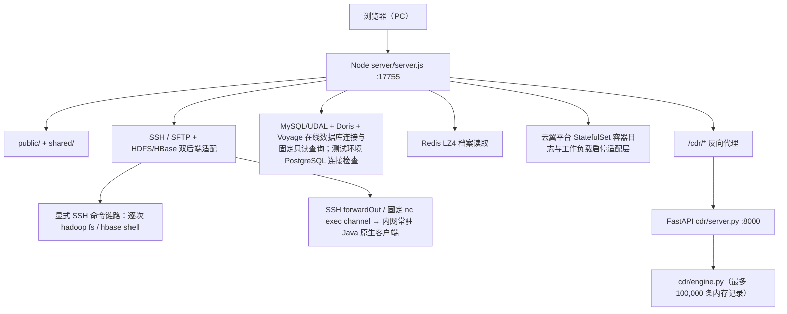

# Server Workbench 项目总览

本项目当前采用 Node.js + FastAPI + 原生 ES Modules 双运行时，面向 Windows/PC 工具场景。Node 负责本地 HTTP、SSH、SFTP、HDFS、数据库查询和 CDR 代理；FastAPI 负责话单内存模型。两者通过同源 `/cdr/` 代理连接。

Windows 桌面交付层使用 Electron + NSIS，主进程管理 Node utilityProcess 和内置 CDR 服务，业务接口仍保持双运行时结构。配置、日志与话单输出放在用户目录，GitHub Releases 负责更新分发；细节见 [Windows 桌面版](./docs/windows-desktop.md)。

## 运行结构

`start.bat` 只从 PATH 查找 `node`、`python`/`py`，不包含个人绝对路径。`.env.example` 展示连接结构，复制成未纳入 Git 的 `.env` 后填写真实连接信息。Node 启动时会报告配置缺失，接口仅返回掩码后的连接状态。

## 前端架构

- `shared/tokens.css` 是纯白工具覆盖：画布/表面白、黑墨层级、荧光黄主操作与选中、蓝色焦点、独立状态色，视觉旋钮按 4/3/6 控制密度、圆角和阴影。
- `shared/ui.js` 提供统一请求错误模型、可区分的超时/主动取消、DOM 节点创建、状态播报、格式化和原生 `dialog` 焦点进入/恢复。
- `shared/icons.svg` 为图标精灵。主工作台和 CDR 前端均使用 `textContent`/节点构造渲染远端数据，不把文件名、路径、字段值拼入 `innerHTML`。
- 主工作台采用资源浏览、数据库查询、Redis 档案、进程日志、话单工具五个独立工作区。`navigation.js` 管理仅含枚举的 hash 路由，`connections.js` 管理相关源状态与右侧连接抽屉，`resource-ui.js` 管理路径编辑、面包屑与行操作菜单，`query-results.js` 管理表格及结果分组，`redis-ui.js` 管理 Redis 子页。页面节点和 CDR iframe 在切页时保留；只有日志页处于前台时恢复其轮询。收藏、备注沿用原存储格式，查询数据与预览不持久化。
- 数据库查询页保留环境选择：测试环境档案查 PostgreSQL `bill_inmemory`、配置查 MySQL/UDAL `CONFIGDB_CNOS_JF_TEST`；工程环境经 Voyage 查询，可选择 `bill_inmemory` / `crmv3`。前端按所选源检查连接并传递 source/schema，切换时取消旧请求并清空结果。号码不等于产品实例 ID，同一号码可能含多个实例/历史；bill_inmemory 实例档案保留 `his_id` 与一跳关系，crmv3 沿用工程档案查询路径。关系链固定 PG/MySQL、Redis 同步固定 PG，不受环境选择影响。
- PG查询复用逻辑到物理表/字段映射：`prod_inst_acct_rel → prod_inst_acct`、`offer_inst → prod_offer_inst`、`offer_inst_rel → prod_offer_inst_rel`、`acc_num → acc_nbr`、销售品关系A/Z字段等；保留物理原值并提供逻辑兼容字段。配置查询不套用该映射，套餐定义读取MySQL `offer`。新增独立“关系链查询”覆盖产品/销售品正反向、功能产品、群主、三类非产品群及对端成员诊断；结果是带履历/状态/角色的原始候选，详见 [档案查询与关系链](./docs/archive-relations.md)。
- “查询套餐”按规格offer_id读取MySQL定义和定价，从PG反查订购销售品实例、产品关系及产品实例。“查询事件类型”保留MySQL事件格式、入库路由、定价策略/组合查询，订购实例与产品关联转查PG。每一步记录实际来源，单分支失败保留已成功数据。
- 阈值查询以 A 端产品实例 ID 为入口，分步读取 `prod_inst_rel`、产品规格为 `900178630` 的 `prod_inst`，以及六个固定档位属性对应的 `prod_inst_attr`，避免 UDAL 子查询路由限制。
- 左侧独立「Redis 档案」页面由 Node 使用 RESP 直连本地 `.env` 指定的 Redis，仅允许读取 `rate:cpp:{数字ID}`；值按 4 字节大端解压长度、原始 LZ4 block、前缀与 JSON 的既有格式解析，浏览器只接收结构化数据，不接收 Redis 密码。
- 主工作台的三类资源列表在已加载数据上本地搜索/排序并保留收藏；HBase 查看窗口只读取指定行数的样本，查找和高亮不触发额外扫描。月度 `ACCUMULATOR_<账期>` 在前端拆解列族 `f` 的 Qualifier；`ACCUMULATOR_DETAIL_<账期>` 拆解 MS/SM RowKey；未处理和已处理话单分发表分别按各自七段 RowKey 拆解来源标识/文件、时间键、分发类型、处理场景和附加编码；采预/批价的在途与已完成主表按批次 ID 汇总 `batch_info` 字段，子表拆解输入/输出方向、来源/目标路径及结果段；原始结果仍用于复制。
- CDR 以「文件与会话 → 记录浏览 → 批量修改/造数 → 导出」顺序组织，字段错误、加载/空/错误状态和影响数量均在原位反馈。

当前默认聚焦 PC 场景，移动端专用布局和深色模式不属于默认实现范围；CSS 仅保留窄视口兜底，PC 缩放不应裁切主要操作。

## 后端契约与性能

### Node

- 请求体限制 1 MiB，非法 JSON/未知字段返回真实 HTTP 状态和 `{ok:false,error:{code,message,retryable}}`。
- `/api/connect`、`/api/db/connect`、`/api/voyage/connect`保留独立连接管理；普通固定查询显式 source=voyage 时经 Voyage 查询并校验 Schema，其余默认 PG 档案/MySQL 配置。关系链接口仍固定 PG/MySQL。PG每次固定SELECT使用位置绑定参数、明确bill_inmemory Schema、只读Repeatable Read事务和15秒单语句超时；日期/大整数保留原值。整条跨PG/MySQL链不承诺同一快照。手机号/实例/关系链查询总超时60秒；关系诊断每步最多500行、每关联组最多100个ID、累计最多5000行。固定接口不接受用户SQL、不执行导出脚本。
- `/api/voyage/status|connect` 仅返回脱敏配置和连接状态；Bearer Token 只由 Node 从 `.env` 读取。适配器把 `columns + rows` 还原为对象，保留不安全大整数为字符串，并把 HTTP、鉴权和语句级错误分开报告。
- `/api/query/redis` 只接收产品实例 ID 或 `rate:cpp:{数字ID}`，逐次认证、选择配置的 DB、GET 并解码 LZ4/JSON。单次连接与查询默认 15 秒，解压长度默认不超过 16 MiB，密码不进入接口响应。
- `/api/redis-index/lookup|preview|apply` 补建根产品号码索引：实例直接定位 CPP；手机号先读 Redis accNbr，缺失时查测试 PG `prod_inst.acc_nbr`，最多 100 个候选。预览从所选 CPP 根 `prodInsts` 分别取 `account` 与 `accNbr`，历史成员去重后编码为二进制 SET。确认后 Lua 核对源字节与全部目标仍缺失，只新增缺失 key，不改已有 key/成员/TTL。写前本地操作记录、写后回读；响应异常保留 uncertain，不自动重放。仅覆盖所选实例，详见 [号码索引补建](./docs/redis-indexes.md)。
- `/api/redis-sync/preview|apply|history|restore` 从 PG 按 `ID + his_id` 更新既有 Redis 档案字段，并追加根产品直接订购关系及销售品实例；其他新增类型仅核对，缺失/未知内容保留，既有记录关联端点变更阻断。新增记录与字段共用候选编码、预览重算、整条备份及恢复；编码重算 Kryo String 字符长度并生成 raw LZ4 block，Redis Lua CAS 写入保留 TTL 并回读验证。恢复绑定连接和同步后的摘要、原绝对过期时间，避免覆盖后续修改；具体边界见 [PG → Redis 同步](./docs/pg-redis-sync.md)。
- `/api/dcos/status|connect|disconnect` 管理临时平台 Cookie，仅在 Node 内存保存且状态不返回凭据；`/api/dcos/namespaces|workloads|pods|logs` 将页面选择映射到云翼平台固定只读接口，工作负载分页由 Node 向上游发 POST。`/api/dcos/workload/start|stop` 把页面确认后的 StatefulSet 启停转发到云翼平台工作负载级接口（POST 空体），按钮可用性以当前 Pod 列表推断。会话过期返回独立错误。容器日志除页面展示外，按目标去重追加到 `logs/dcos/<集群>__<命名空间>__<Pod>__<容器>.log`（已被 `.gitignore` 覆盖，写盘失败不影响页面读取）：自动刷新重复拉取同一「末尾 N 行」窗口时，只把窗口外新增的行追加进去；进程重启后回读文件尾部继续去重；单文件超过 20 MiB 轮转为 `.1.log`。由于平台只有末尾快照接口，两次拉取之间滚出窗口的行仍会缺失。
- UDAL 按逻辑库建立 `utf8mb4` 连接，不在查询中写库名前缀；结果中的大整数、金额和日期保留字符串。可无损识别的 UTF-8/GB18030 历史错码业务名称恢复显示并保留原始值。分支失败、关联缺失与空结果分别返回，跨库结果不表示同一事务快照。
- 浏览器日期格式化、查询元数据、SFTP 修改时间和 CDR 生成时间均显式使用 UTC+8；数据库业务日期字符串保持原值并标注 UTC+8，不做二次偏移。
- `/api/sftp/list|preview|mkdir|touch|delete|download` 使用结构化 SFTP；删除区分 file/空 dir，根路径保护。
- `/api/bigdata/status|connect|use-ssh` 独立管理 HDFS/HBase 常驻客户端来源。客户端仅监听内网机器环回地址，Node 通过已建立 SSH 会话为每个请求创建 `forwardOut` 加密通道；Token 不进入响应或日志。切换来源会取消旧请求并清空已加载资源，故障不静默切换。
- `/api/hdfs/list|preview|download|upload|mkdir|touch|delete` 和 `/api/hbase/list|scan` 保持页面契约；上传在客户端模式使用常驻 `FileSystem.copyFromLocalFile`，删除只允许文件或空目录且必须二次确认，不执行递归删除。`mkdir|touch` 只接受「当前目录 + 单层名称」，由 Node 拼路径后走 SSH 命令链路（常驻客户端服务未提供这两个接口），同名目标不覆盖、父目录缺失和权限不足分别单独报错。客户端模式额外返回 `source/cached/readAt/durationMs`。HDFS 与 HBase 数据读取默认实时，仅命名空间和表列表缓存 30 秒，手动刷新绕过缓存。`/api/hbase/get` 提供 RowKey 精确查询；扫描最多 200 行，预览最多 256 KiB。
- 命令 stdout/stderr 共用 2 MiB 预算并返回 `truncated`；参数化路径统一使用单引号 shell 转义，交互式命令和根目录递归强删在执行层拦截。
- 目录刷新、HDFS 刷新和自动刷新有 AbortController/代际门禁；页面隐藏时暂停，单个刷新请求不会重入。

### CDR

- `load_file` 逐行验证 NDJSON，只接受对象并在错误中报告行号；完整解析成功后才替换会话。
- 字段类型采用观察集合：整数+浮点推断为 float，字符串/其他混合推断为 str；ID 使用 O(1) 索引。
- 会话 revision 随修改递增，`GET /api/session` 支持刷新恢复；写操作可携带 `expected_revision`，冲突返回 409。
- 批量预览与实际应用共用转换/时间校验；无筛选的批量修改拒绝执行。造数先计算总量，超过 100,000 条拒绝；撤销栈有深度和变更预算。
- 导出先写同目录临时文件，验证 JSON 可读、`TICKET_COUNT`、ID 唯一性和时间格式，全部通过后 `os.replace` 原子替换。

## 测试与限制

Node builtin tests 覆盖 shell 转义、危险删除、真实错误状态、日志分页；Python unittest 覆盖非法 NDJSON、混合类型、ID 生成、批量一致性、版本/容量/原子导出等。测试使用假数据和临时目录，不接触真实凭据。

`npm run test:browser` 运行 Playwright，用隔离的真实 CDR 引擎和模拟的远端接口覆盖页面切换、结果分组、ID 联动、取消/过期响应、Redis 写入保护、日志轮询及话单操作。布局测试包含 1024/1366/1920 宽度和 125%/150% 缩放对应的有效 CSS 视口，截图保存在忽略提交的 `outputs/ui-redesign/`。首次运行需 `npx playwright install chromium`；可用 `WORKBENCH_BROWSER_CHANNEL=chrome` 选择本机 Chrome，或用 `WORKBENCH_PYTHON` 指定测试服务的 Python。真实 SSH/SFTP/HDFS smoke 仍需本机 `.env` 和内网；有效视口测试不替代 Windows 实机验收。
